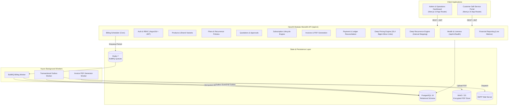

# Brightloop Subscription Management System (SMS)

[](https://github.com/albin170/make-a-thon/actions/workflows/ci.yml)
[](https://www.typescriptlang.org/)
[](https://nestjs.com/)
[](https://nextjs.org/)
[](https://www.prisma.io/)
[](https://www.postgresql.org/)

Brightloop SMS is an enterprise-grade TypeScript modular monolith engineered for end-to-end subscription lifecycle orchestration, automated recurring billing, precise multi-currency pricing, PDF invoicing, manual payment reconciliation, and real-time financial reporting.

---

## Architecture Overview



---

## Core Capabilities

- **Subscription Lifecycle Management**: Full state-machine transitions across `DRAFT`, `PENDING_APPROVAL`, `ACTIVE`, `PAUSED`, `OVERDUE`, `CANCELLED`, and `EXPIRED` with immutable audit logs.
- **Server-Side Pricing Engine**: High-precision arithmetic using integer minor units (18,4 fixed scale via `BigInt`) to eliminate floating-point drift, supporting both inclusive and exclusive VAT/tax rates, line-item discounts, and variant price adjustments.
- **Automated Recurring Billing Engine**: BullMQ-backed scheduler computing deterministic idempotency keys (`${subscriptionId}::${YYYY-MM-DD}`) to prevent duplicate charges and race conditions across retry attempts.
- **Consolidated Recurrence Engine**: Unified interval projection across `DAILY`, `WEEKLY`, `MONTHLY`, and `YEARLY` cadence with leap-safe month clamping.
- **Invoicing & PDF Generation**: Automated invoice issuance with PDF streaming via PDFKit and S3/MinIO cloud persistence.
- **Payment Reconciliation**: Partial and full payment allocations with balance deductions, over-allocation guards, and overdue status detection.
- **Role-Based Access Control (RBAC)**: Argon2id password hashing, HTTP-only JWT sessions with rotation, global route throttling, and security headers (Helmet).
- **Container Health & Liveness Checks**: Dedicated `/api/v1/health` endpoint for container orchestrators and cloud platforms.

---

## Technology Stack

| Layer | Technologies |
|---|---|
| **Web Frontend** | Next.js 14 (App Router), React 18, TypeScript, Tailwind CSS, Headless UI, Heroicons |
| **Backend API** | NestJS 10, Express, TypeScript, class-validator, Helmet, Winston, OpenAPI/Swagger |
| **Database & ORM** | PostgreSQL 16, Prisma ORM 5.x (Fixed decimal 18,4, UUID primary keys) |
| **Job Queues & Cache** | Redis 7, BullMQ (exponential backoff, deduplication via `jobId`) |
| **Security & Auth** | Argon2id, JWT (Passport.js), HTTP-only cookies, Rate Limiting |
| **Document Generation** | PDFKit (streaming), AWS S3 / MinIO storage |
| **Testing** | Jest 29, `@types/jest`, `ts-jest`, Supertest |
| **Local Infrastructure** | Docker Compose (PostgreSQL, Redis, MinIO, MailHog) |

---

## Repository Structure

```text
make-a-thon/
├── apps/
│   ├── web/                     # Next.js 14 frontend (Admin & Customer Portal)
│   ├── api/                     # NestJS REST API
│   │   ├── src/
│   │   │   ├── auth/            # Authentication & RBAC guards
│   │   │   ├── billing/         # Billing engine & scheduler
│   │   │   ├── common/          # Cross-cutting modules
│   │   │   │   ├── pricing/     # Server-side high-precision pricing engine
│   │   │   │   ├── recurrence/  # Unified recurrence & period key engine
│   │   │   │   └── prisma/      # Database client service
│   │   │   ├── customers/       # Customer profile management
│   │   │   ├── health/          # API liveness & container health checks
│   │   │   ├── invoices/        # Invoicing, PDF streaming & balances
│   │   │   ├── payments/        # Payment recording & reconciliation
│   │   │   ├── plans/           # Subscription plans & tiers
│   │   │   ├── products/        # Product catalog & variant adjustments
│   │   │   ├── quotations/      # Quotations & auto-conversion
│   │   │   ├── reports/         # Financial metrics & aggregations
│   │   │   └── users/           # User & staff administration
│   │   └── package.json
│   └── worker/                  # Background BullMQ queue processors
├── prisma/                      # Schema definition and database seed script
├── infra/                       # Docker infrastructure assets
├── tests/                       # Monorepo integration test suites
│   └── integration/
│       ├── auth.test.ts         # Security & authentication tests
│       ├── billing.test.ts      # Billing idempotency & date stepping tests
│       ├── payments.test.ts     # Allocation & reconciliation tests
│       └── pricing.test.ts      # BigInt pricing engine & tax precision tests
├── .github/workflows/ci.yml     # Automated CI/CD pipeline
├── docker-compose.yml           # Supporting infrastructure
└── package.json                 # Monorepo workspaces configuration
```

---

## Getting Started

### Prerequisites

Ensure you have installed:
- **Node.js** >= 20.x LTS
- **npm** >= 10.x
- **Docker Desktop** (with Docker Compose)
- **Git**

### 1. Clone & Install Dependencies

```bash
git clone https://github.com/albin170/make-a-thon.git
cd make-a-thon
npm install
```

### 2. Configure Environment

Copy the example environment configuration:

```bash
# Linux / macOS
cp .env.example .env

# Windows PowerShell
Copy-Item .env.example .env
```

Review `.env` and configure your credentials as appropriate.

### 3. Start Local Infrastructure

Launch PostgreSQL, Redis, MinIO, and MailHog via Docker Compose:

```bash
docker compose up -d postgres redis minio mailhog
```

Service endpoints:
- **Web App**: `http://localhost:3000`
- **REST API**: `http://localhost:3001`
- **Swagger Docs**: `http://localhost:3001/api/docs`
- **Health Check**: `http://localhost:3001/api/v1/health`
- **MailHog Inbox**: `http://localhost:8025`
- **MinIO Console**: `http://localhost:9001` (User: `minioadmin`, Pass: `minioadmin`)

### 4. Database Setup & Seeding

Generate the Prisma client, apply database migrations, and seed sample data:

```bash
npx prisma generate
npm run db:migrate
npm run db:seed
```

To explore the database visually:
```bash
npm run db:studio
```

### 5. Running the Application

To run all workspaces (API, Web, Worker) concurrently:

```bash
npm run dev
```

Or run individual services:

```bash
npm run dev:api     # NestJS API on http://localhost:3001
npm run dev:web     # Next.js Web on http://localhost:3000
npm run dev:worker  # BullMQ background worker
```

---

## Testing & Quality Assurance

The codebase includes comprehensive unit and integration test suites:

```bash
# Run unit tests across workspaces
npm test

# Run end-to-end integration test suites
npx jest tests/integration/auth.test.ts tests/integration/pricing.test.ts tests/integration/billing.test.ts tests/integration/payments.test.ts

# Validate TypeScript compilation & production builds
npm run build --workspace=apps/api
npm run build --workspace=apps/web
```

---

## Cloud Deployment

- **Backend API (Render)**: Managed via [`render.yaml`](render.yaml) with automatic zero-downtime deploys and health checks pointed at `/api/v1/health`.
- **Frontend App (Vercel)**: Managed via [`vercel.json`](vercel.json) optimized for Next.js static generation and serverless execution.

---

## License

Private and proprietary. All rights reserved by Brightloop Software.
