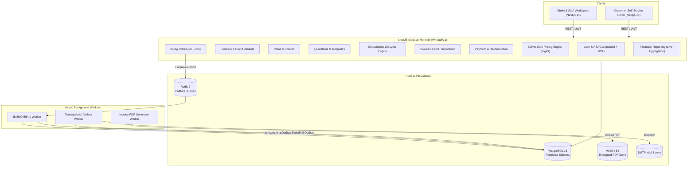

# Brightloop SMS — System Architecture Documentation

## 1. Executive Overview

Brightloop Subscription Management System (SMS) is an enterprise-grade TypeScript modular monolith engineered for end-to-end subscription lifecycle orchestration, recurring billing execution, automated invoicing, manual payment reconciliation, and real-time financial reporting.

## 2. High-Level Architecture Diagram

## 3. Technology Stack Breakdown

- **Frontend**: Next.js 14 App Router, React 18, TypeScript, Tailwind CSS, Heroicons, Headless UI.
- **Backend**: NestJS 10, Express, TypeScript, class-validator, Helmet, Winston, OpenAPI/Swagger.
- **ORM & Database**: Prisma ORM, PostgreSQL 16 (UUID primary keys, fixed decimal precision 18,4, foreign key constraints).
- **Job Queues & Scheduler**: Redis 7, BullMQ (exponential backoff, deduplication jobId).
- **Document Generation**: PDFKit (server-side streaming) and AWS S3 / MinIO storage.
- **Security**: Argon2id password hashing, HTTP-only JWT sessions, rate limiting, and zero plaintext token persistence.

